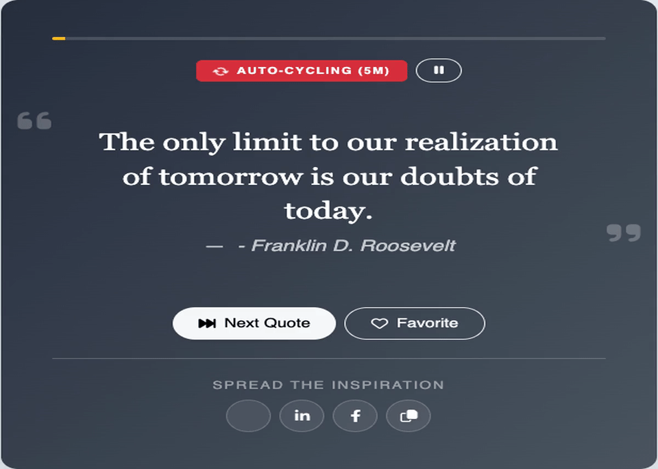
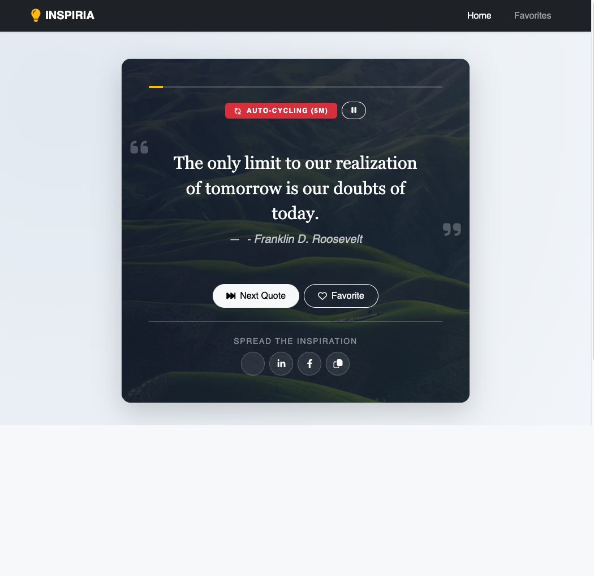
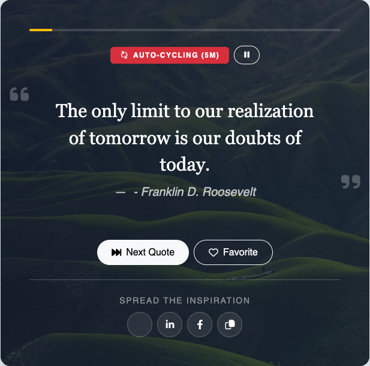
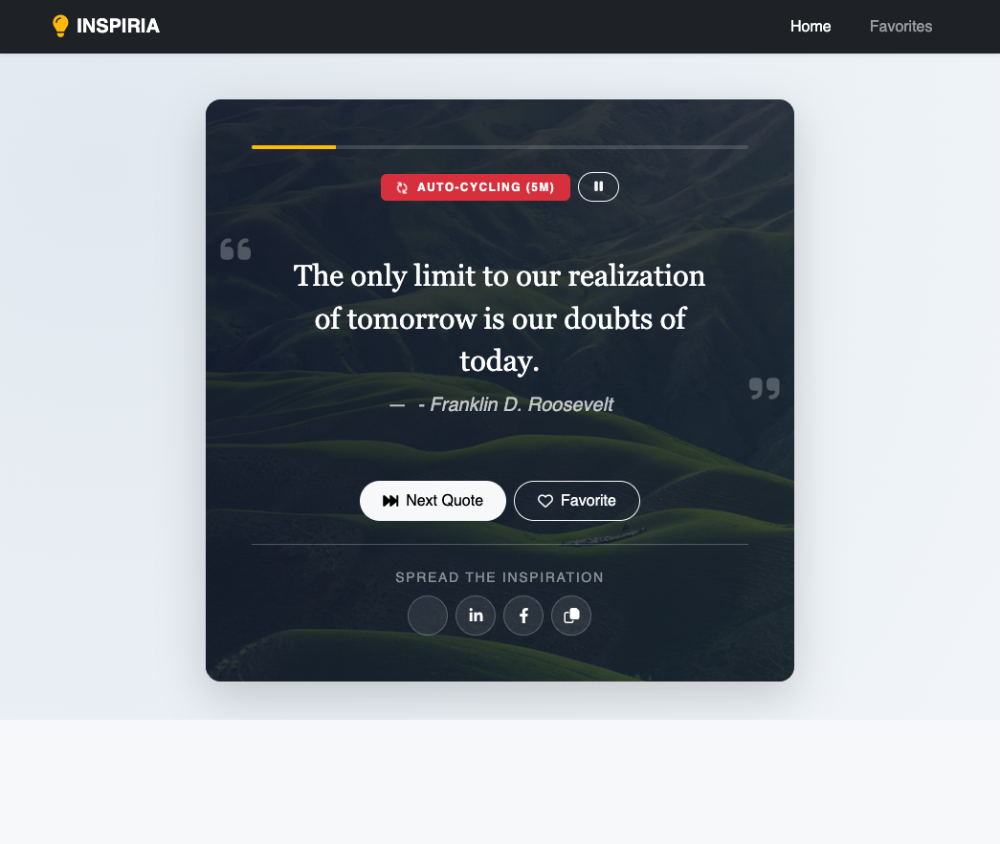

# Inspiria — Beautiful Quote of the Day & Wisdom Card Generator

Inspiria is a gorgeous, responsive **Quote of the Day** showcasing web application designed to trigger waves of high-energy motivation, positive insight, and elegant wisdom cards in the browser workspace.

This application is decoupled into a robust back-end server REST API built via **Node.js + Express** and a fast, accessible front-end interface built via **Bootstrap v5, HTML, CSS, and Vanilla JavaScript**.

---

## 🌟 Core Features & Solutions Completed

- **5-Minute Dynamic Automation:** Fully automated slides cycle quotes smoothly every 5 minutes supported by a synchronized visual progress-bar indicator. Includes pause, resume, and instant next-quote triggers.
- **Micro-Cached Back-End Feed:** Serve curated entries from `/api/quotes` including cache TTL (Time To Live 30s) implementation tracking live data-source (`database` vs `cache`) returned with response performance tags.
- **Social Media Share Platform:** Includes customized actions and hooks to instantly compose social share tags on Twitter (X), LinkedIn, Facebook, and copy full quote citations directly to user clipboards.
- **Personalized Local Favorites:** Save liked quotes directly to the user's browser space via `LocalStorage` directory lists. Keep bookmarks safe across browser refreshes with quick remove operations and interactive status badges.
- **Interactive UI Transitions:** High-fidelity animations with modern Unsplash nature/meadows card background gradients that shift in sync with quote rotations.
- **Robust Connection Guardrails:** Full network connection diagnostic reporting with visual loaders, spinners, and friendly, action-rich fallback reload-button elements on API error events.
- **Showcase SEO Optimization:** High-quality semantic Open Graph tags, responsive titles, search descriptions, and viewport control meta features compiled for cross-platform indexing.

---

## 🛠️ Technology Stack Architecture

- **Backend Platform:** Node.js (ES Modules syntax support), Express Framework
- **Security & Helpers:** Helmet (Strict Content Security Policy rules), CORS
- **Frontend Design:** Bootstrap 5 (Responsive Layout UI), FontAwesome 6 Core icons
- **Layout & Structure:** Google Fonts (Playfair Display & Plus Jakarta Sans), Custom Modern CSS theme layers, Vanilla JS client-side DOM controller
- **Storage Profile:** LocalStorage persistent browser memory space

---

## 🚀 Running the Project Locally

Follow these quick commands to spin up the server environment:

```bash
# 1. Install Node package dependencies
npm install

# 2. Start the local server
npm start
```

After launching, load up [http://localhost:3000](http://localhost:3000) inside your web browser to play around with the application!

---

## 📸 Application Screenshots

## 🎬 Animated Demo



**Caption:** Transition demo captured by clicking the **Next Quote** button 5 times, showcasing smooth quote changes, typography styling, and animated card presentation.

For higher-quality playback, see the MP4 version: [View Demo Video](docs/screenshots/quotes-transition.mp4)

### Regenerate Quote Transition Media

You can regenerate the 5-step quote transition screenshots and both video formats (GIF + MP4) anytime the app UI changes:

```bash
npm run demo:quotes
```

What this script does:

- Opens the app with Playwright
- Clicks **Next Quote** repeatedly and captures 5 different quote frames
- Rebuilds [docs/screenshots/quotes-transition.mp4](docs/screenshots/quotes-transition.mp4)
- Rebuilds [docs/screenshots/quotes-transition.gif](docs/screenshots/quotes-transition.gif)

---

### 1) Dashboard Overview



**Caption:** The main dashboard displays the current quote, author attribution, auto-cycle status badge, and progress indicator. This is the primary view where users can browse quotes and interact with key actions.

### 2) Quote Controls & Sharing



**Caption:** The action area highlights core functionality including next quote navigation, favorites toggle, and one-click sharing to X, LinkedIn, Facebook, plus clipboard copy for quick reuse.

### 3) Favorites Collection View



**Caption:** The favorites interface shows saved quotes persisted in local storage, allowing users to build a personal quote library and manage entries in one dedicated view.
